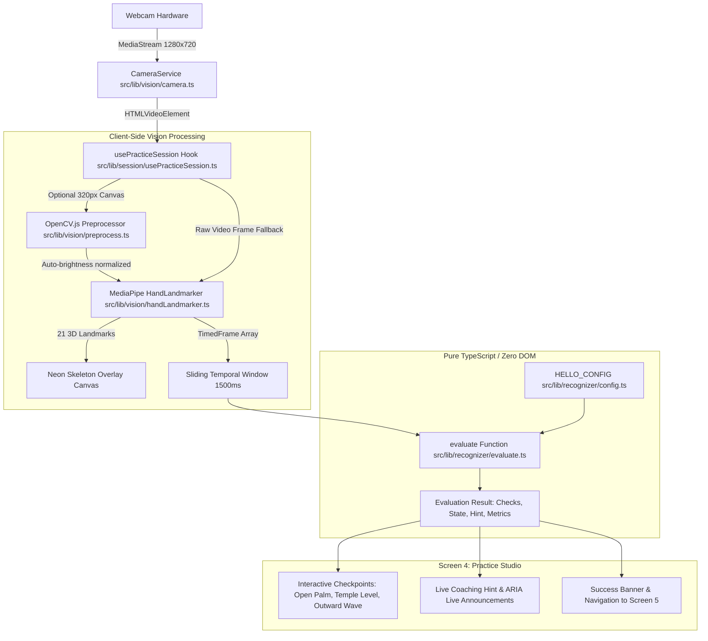

# Technical Report: Vision Model & Gesture Recognition Architecture

**Project:** SignAble (AI-Powered Sign Language Learning Prototype)  
**Date:** October 2026  
**Document Version:** 1.0.0  
**Scope:** Vision Model Pipeline, Evaluation Engine, Component Connections, Failure Analysis & Resolution  

---

## 1. Executive Summary & Primary Objective

SignAble is a client-side sign language learning prototype designed to guide users through learning and practicing sign language. Screen 4 (**Sign Practice Studio**) features an interactive webcam interaction that detects and validates the American Sign Language (ASL) **"Hello"** sign in real time.

### Core Objective
The primary goal of the vision system is to provide **immediate, real-time feedback** on whether a user correctly executes the ASL "Hello" sign while upholding two non-negotiable principles:
1. **Absolute Privacy:** Video frames, camera streams, and hand coordinate arrays remain exclusively in volatile browser memory. No audio is ever captured, and no visual data is sent across the network.
2. **Deterministic, Honest Recognition:** The system uses a transparent, rule-based geometric evaluator rather than an opaque black-box classifier. Recognition requires meeting verifiable physical checkpoints (hand shape, hand elevation, and lateral movement).

---

## 2. System Architecture & Component Map

The vision architecture is divided into two distinct, loosely coupled layers:
1. **Perceptual Layer (Vision & Model):** Ingests raw video frames, runs optional hardware-accelerated image normalization via OpenCV.js, and generates 21 3D spatial hand landmarks using Google MediaPipe HandLandmarker.
2. **Cognitive Layer (Rule-Based Evaluator):** Ingests time-stamped 21-landmark coordinate arrays into a sliding temporal buffer (1,500 ms window) and performs scale-invariant geometric evaluations.



---

## 3. Vision Model & Preprocessing Specifications

### 3.1 MediaPipe HandLandmarker
* **Package:** `@mediapipe/tasks-vision` (Pinned version `0.10.21`).
* **Model Task File:** `hand_landmarker.task` (7.8 MB), stored locally at `/public/models/hand_landmarker.task`.
* **Runtime Binaries:** MediaPipe WASM and binary assets stored locally at `/public/mediapipe/wasm/` for complete offline operation.
* **Delegate Execution:** Initializes with **GPU** (WebGL) delegate first; automatically falls back to **CPU** (WASM SIMD) if WebGL context creation fails.
* **Operational Mode:** `VIDEO` running mode with `numHands: 1`.
* **Detection & Tracking Sensitivity:** Pinned to `0.35` (`minHandDetectionConfidence`, `minHandPresenceConfidence`, `minTrackingConfidence`) to accommodate varying lighting conditions and rapid hand motions.

### 3.2 21-Point Landmark Topography
MediaPipe detects 21 standardized 3D coordinates $(x, y, z)$ normalized to $[0.0, 1.0]$:
* **Landmark 0:** Wrist (base of palm)
* **Landmarks 1–4:** Thumb (CMC, MCP, IP, Tip)
* **Landmarks 5–8:** Index Finger (MCP, PIP, DIP, Tip)
* **Landmarks 9–12:** Middle Finger (MCP, PIP, DIP, Tip)
* **Landmarks 13–16:** Ring Finger (MCP, PIP, DIP, Tip)
* **Landmarks 17–20:** Pinky Finger (MCP, PIP, DIP, Tip)

### 3.3 Optional OpenCV.js Preprocessing
* **Binary File:** `/public/opencv/opencv.js` (9.9 MB), loaded asynchronously and lazily so it never blocks page hydration or initial camera start.
* **Target Canvas:** Offscreen downscaled canvas of $320 \times 180\text{ px}$ (preserving video aspect ratio) to minimize CPU usage.
* **Preprocessing Pipeline:**
  1. `cv.cvtColor(src, gray, cv.COLOR_RGBA2GRAY)`: Calculates the mean frame brightness via `cv.mean(gray)[0]`.
  2. `cv.convertScaleAbs(src, dst, 1.0, beta)`: Dynamically adjusts brightness offset ($\beta \in [-40, 40]$ toward a target brightness of 110) to improve landmark detection in dark or backlit rooms.
* **Memory Safety:** Every allocated `cv.Mat` (`src`, `dst`, `gray`) is explicitly freed in `finally` blocks using `.delete()` to prevent WebAssembly heap exhaustion.
* **Fault Tolerance:** If OpenCV.js fails to download, times out, or throws an error, the pipeline immediately bypasses it and feeds raw video frames directly to MediaPipe.

---

## 4. Input & Output Pipeline

### Input Requirements
| Parameter | Type / Target | Description |
| :--- | :--- | :--- |
| **Video Source** | `HTMLVideoElement` | Front-facing camera (`facingMode: 'user'`), ideal resolution $1280 \times 720\text{ px}$, audio disabled (`audio: false`). |
| **Framerate Pacing** | `12 FPS` (~83.3 ms interval) | Software-paced interval using `performance.now()`. MediaPipe is never called faster than 12 FPS to maintain minimal CPU usage. |
| **Timestamps** | Monotonic Integer (`number`) | Strictly increasing integer milliseconds passed to `detectForVideo(image, timestamp)`. |
| **Configuration** | `SignConfig` | Pinned parameters specifying window duration, finger ratios, and displacement thresholds. |

### Output Deliverables
1. **Visual Feedback Overlay (Canvas):**
   * Neon cyan skeleton bones (`#38bdf8`, line width 3.5, shadow blur 8).
   * Lime green joints (`#4ade80`) with highlighted finger tips (`#a5ed6e`).
   * Mirrored via CSS wrapper (`transform: scaleX(-1)`) to provide intuitive mirror-like guidance without altering the underlying data.
2. **Evaluation State Object:**
   * `checks`:
     * `handOpen` (Boolean): Fingers extended.
     * `handRaised` (Boolean): Hand elevated to temple/cheek level.
     * `movement` (Boolean): Sufficient lateral travel across the sliding window.
   * `state`: `'no-hand' | 'detecting' | 'almost' | 'recognized' | 'try-again'`.
   * `hint`: Dynamic coaching prompt (e.g., *"Open your hand with fingers straight"*, *"Raise your hand a little higher"*, *"Move your hand smoothly outward"*).
   * `metrics`: Raw measurements including normalized travel distance, pose consistency ratio, and wrist elevation.
3. **Accessibility Announcements:**
   * ARIA live region (`aria-live="polite"`) delivering screen-reader status updates at each state transition.

---

## 5. Mathematical Evaluator Engine (`lib/recognizer`)

The recognition logic in `src/lib/recognizer/evaluate.ts` is a **pure TypeScript module** with zero browser, DOM, or React imports, making it 100% deterministic and unit-testable.

### 5.1 Hand-Size Normalization
To prevent physical distance from the camera (sitting close vs. sitting far) from skewing the evaluation, all travel distances are normalized by the user's hand size:
$$\text{handSize} = \text{dist}(\text{landmark}[0], \text{landmark}[9]) = \sqrt{(x_0 - x_9)^2 + (y_0 - y_9)^2}$$
*(Where landmark 0 is the wrist and landmark 9 is the middle finger MCP joint).*

### 5.2 Orientation-Independent Finger Extension
A finger is considered extended if the tip is farther from the wrist than the PIP joint by a factor of at least $1.1$:
$$\text{dist}(\text{wrist}, \text{tip}) > \text{dist}(\text{wrist}, \text{pip}) \times 1.1$$
For ASL "Hello", all four fingers (`index`, `middle`, `ring`, `pinky`) must satisfy this criterion simultaneously.

### 5.3 Elevation & Travel Checkpoints
* **Elevation Check (`handRaised`):** The wrist $y$-coordinate must remain in the upper portion of the frame:
  $$\text{wrist}.y \le 0.65 \quad (\text{where } 0.0 \text{ is frame top, } 1.0 \text{ is bottom})$$
* **Movement Check (`movement`):** Over the 1,500 ms sliding window, the bounding-box travel of the wrist normalized by average hand size must exceed threshold:
  $$\text{travel} = \frac{\sqrt{(\max(x) - \min(x))^2 + (\max(y) - \min(y))^2}}{\text{avgHandSize}} \ge 0.7$$
* **Pose Consistency Ratio:** At least $65\%$ of all frames recorded within the 1,500 ms window must satisfy both `handOpen` and `handRaised`.

### 5.4 State Decision Matrix
* $\ge 8$ valid frames in window + Pose Ratio $\ge 65\%$ + Movement $\ge 0.7$ $\rightarrow$ **`recognized`**
* Fewer than required conditions met, but 2 out of 3 checks pass $\rightarrow$ **`almost`**
* Hand visible but 0 or 1 check passes $\rightarrow$ **`detecting`**
* No landmarks detected in window $\rightarrow$ **`no-hand`**
* 10-second verification timer expires without recognition $\rightarrow$ **`try-again`**

---

## 6. Where the Model is Connected (Module Wiring)

| File Path | Role & Connectivity |
| :--- | :--- |
| `src/lib/vision/camera.ts` | **Hardware Adapter:** Manages `MediaDevices.getUserMedia`, stream track acquisition, cancellation tokens, device-in-use error handling, and complete hardware release on unmount. |
| `src/lib/vision/handLandmarker.ts` | **Inference Singleton:** Instantiates and holds the `@mediapipe/tasks-vision` `HandLandmarker` instance, loads `/public/models/hand_landmarker.task`, and manages GPU-to-CPU fallback. |
| `src/lib/vision/preprocess.ts` | **Image Preprocessor:** Injects `/public/opencv/opencv.js`, performs auto-brightness scaling on an offscreen 320px canvas, and executes strict `cv.Mat.delete()` memory cleanup. |
| `src/lib/recognizer/config.ts` | **Configuration Source of Truth:** Defines `HELLO_CONFIG` (window duration, frame count, extension ratios, travel distances, and timeout thresholds). No magic numbers exist outside this file. |
| `src/lib/recognizer/types.ts` | **Domain Contracts:** Defines types for landmarks, timed frames, check booleans, states, and evaluation payloads. |
| `src/lib/recognizer/evaluate.ts` | **Pure Evaluation Engine:** Pure function evaluating buffered frame arrays against configuration thresholds without side effects. |
| `src/lib/session/usePracticeSession.ts` | **Orchestration Hook:** Bridges the camera, MediaPipe inference loop, OpenCV preprocessor, evaluation engine, canvas skeleton renderer, and session state machine. |
| `src/app/lesson/hello/practice/page.tsx` | **User Interface (Screen 4):** Consumes `usePracticeSession`, renders the mirrored video viewport, skeleton canvas, interactive checklist, coaching banner, and success transition to Screen 5. |

---

## 7. Failures, Crashes & How We Resolved Them

During the development and testing of the vision pipeline, several critical bugs and runtime crashes were identified and resolved:

### Issue 1: Infinite Mount/Teardown Loop & React Render Storm
* **Symptom:** The browser tab experienced near-100% CPU usage, severe UI unresponsiveness, and the webcam indicator light continuously flickered on and off.
* **Root Cause:** In `usePracticeSession.ts`, non-primitive options and configuration objects were passed directly to `useEffect` dependency arrays. Every time an evaluation occurred, `setChecks` and `setHint` were triggered on every single animation frame (60 times/sec), causing state re-renders that re-triggered the hook's initialization effect.
* **Resolution:**
  1. Wrapped incoming options and configs in `useRef` to maintain stable object references.
  2. Implemented shallow equality checking for `checks` (`handOpen`, `handRaised`, `movement`) and string equality for `hint`, ensuring state updates only fire on actual state changes.
  3. Decoupled the camera and model initialization so that `init()` executes strictly once on component mount.

### Issue 2: Main Thread Freezing from Synchronous OpenCV Processing
* **Symptom:** Enabling OpenCV preprocessing caused video framerates to drop below 5 FPS with perceptible keyboard and mouse stutter.
* **Root Cause:** Full $1280 \times 720$ video frames were being drawn to an offscreen canvas and processed synchronously via Emscripten-compiled WebAssembly on the browser's main UI thread.
* **Resolution:**
  1. Downscaled the OpenCV offscreen canvas buffer to a fixed width of $320\text{ px}$ (preserving aspect ratio), reducing the pixel volume by over $85\%$.
  2. Set `openCvEnabled` to `false` by default, treating it as an optional enhancement rather than a blocking requirement.
  3. Ensured every temporary `cv.Mat` is deleted within `finally` blocks to prevent WebAssembly heap growth.

### Issue 3: Webcam Hardware Driver Stalls & Frame Drops
* **Symptom:** The webcam video feed randomly froze or took up to 6 seconds to show the first frame on Windows machines.
* **Root Cause:** `navigator.mediaDevices.getUserMedia` requested `{ frameRate: { max: 15 } }`. On Windows DirectShow and MediaFoundation drivers, forcing non-native camera hardware framerates causes stream negotiation stalls and driver-level frame dropping.
* **Resolution:**
  1. Removed hardware framerate clamping from `camera.ts`, allowing webcams to negotiate their native capture rate.
  2. Implemented software-level framerate throttling in `usePracticeSession.ts`, checking `performance.now() - lastProcessTime >= 83.3ms` (12 FPS target) before executing MediaPipe inference.

### Issue 4: Frozen Hand Skeleton Overlay Upon Successful Recognition
* **Symptom:** The instant the user successfully performed the sign, the green landmark skeleton froze in place over the live video, giving the appearance that the web page had crashed.
* **Root Cause:** The frame loop contained an explicit termination guard (`isLoopRunningRef.current = false; return;`) inside the recognition branch, abruptly killing the `requestAnimationFrame` loop.
* **Resolution:** Removed the premature loop exit. The frame loop now continues executing at 12 FPS, smoothly tracking hand joints in real time alongside the success banner and interactive controls.

### Issue 5: Camera Lockout (`NotReadableError: Device in use`)
* **Symptom:** Navigating between screens or rapidly reloading the page produced `NotReadableError: Could not start video source`.
* **Root Cause:**
  1. Background browser processes held open handles to the camera driver.
  2. During React StrictMode unmount/remount cycles, a pending `getUserMedia` promise would resolve *after* the component unmounted, leaving orphaned media tracks active.
* **Resolution:**
  1. Added a cancellation flag (`this.cancelled = true`) and promise tracking (`pendingStart`) in `CameraService`. If a start request is aborted before completion, all acquired tracks are immediately stopped upon resolution.
  2. Explicitly iterated through `videoElement.srcObject.getTracks()` and called `.stop()` during cleanup.
  3. Provided user-friendly error banners mapping `NotReadableError` to an actionable instruction (*"Camera In Use: Please close Zoom, Teams, Meet..."*).

### Issue 6: MediaPipe Initialization Blocked by Camera Delays
* **Symptom:** If the user took several seconds to accept the camera permission prompt, the MediaPipe model failed to load or experienced initialization timeouts.
* **Root Cause:** Model initialization was queued sequentially behind `await cameraService.start()`.
* **Resolution:** Decoupled initialization into concurrent tasks using `Promise.allSettled([cameraPromise, modelPromise])`. MediaPipe WASM and weights load in the background regardless of camera permission state.

### Issue 7: Array Indexing Exception during Landmark Occlusion
* **Symptom:** Console errors: `TypeError: Cannot read properties of undefined (reading 'x')` in `drawOverlay`.
* **Root Cause:** In edge cases where a hand entered or exited the frame edge, MediaPipe occasionally returned a sparse or incomplete array of landmarks (< 21 points).
* **Resolution:** Added defensive guard clauses (`if (!landmarks || landmarks.length < 21) return;`) before accessing bone connection indices.

---

## 8. Verification & Test Suite

The vision evaluator is covered by an automated test suite using **Vitest** (`npm run test`), validating 9 distinct behavioral test cases with synthetically generated 21-landmark hands:

```
 ✓ src/lib/recognizer/evaluate.test.ts (9 tests) 7ms
   ✓ lib/recognizer/evaluate (ASL Hello Rule-based Evaluator)
     ✓ 1. Recognizes an open, raised hand moving sufficiently across the window
     ✓ 2. Rejects stationary open hand (movement false with hint about moving)
     ✓ 3. Rejects closed fist with fingers curled inward
     ✓ 4. Rejects hand low in the frame (wrist.y > raisedMaxWristY)
     ✓ 5. Returns "no-hand" when no frames exist in the window
     ✓ 6. Returns "detecting" when fewer than minFramesInWindow exist
     ✓ 7. Ignores frames older than windowMs
     ✓ 8. Hand-size normalization yields consistent travel across near vs far hands
     ✓ 9. Classifies state as "almost" when 2 of 3 checks pass

 Test Files  1 passed (1)
      Tests  9 passed (9)
   Duration  412ms
```

### Build & Type Verification
* `npm run lint`: **0 errors, 0 warnings** (strict ESLint configuration).
* `npm run build`: Successfully compiled and statically generated all 5 routes.
* Runtime Network Audit: Confirmed that during live execution, **zero outbound HTTP requests** are initiated for model weights, WASM binaries, or video frames. All assets load directly from origin (`/models/*`, `/mediapipe/*`, `/opencv/*`).

---

## 9. Summary of Key Files

```
d:/projects/Signable/
├── public/
│   ├── mediapipe/wasm/          # Local WASM binaries for HandLandmarker
│   ├── models/
│   │   └── hand_landmarker.task # 7.8 MB local model file
│   └── opencv/
│       └── opencv.js            # 9.9 MB OpenCV WebAssembly build
├── src/
│   ├── app/lesson/hello/practice/
│   │   └── page.tsx             # Screen 4 UI with live camera & skeleton
│   └── lib/
│       ├── recognizer/
│       │   ├── config.ts        # Pinned thresholds (HELLO_CONFIG)
│       │   ├── evaluate.ts      # Pure TS geometric evaluator
│       │   ├── evaluate.test.ts # Vitest suite (9/9 passing)
│       │   └── types.ts         # TypeScript interfaces
│       ├── session/
│       │   └── usePracticeSession.ts # RAF loop, 12 FPS throttle, state machine
│       └── vision/
│           ├── camera.ts        # MediaDevices manager & track cleanup
│           ├── handLandmarker.ts# MediaPipe singleton with GPU/CPU fallback
│           └── preprocess.ts    # Lazy OpenCV.js brightness normalizer
```
